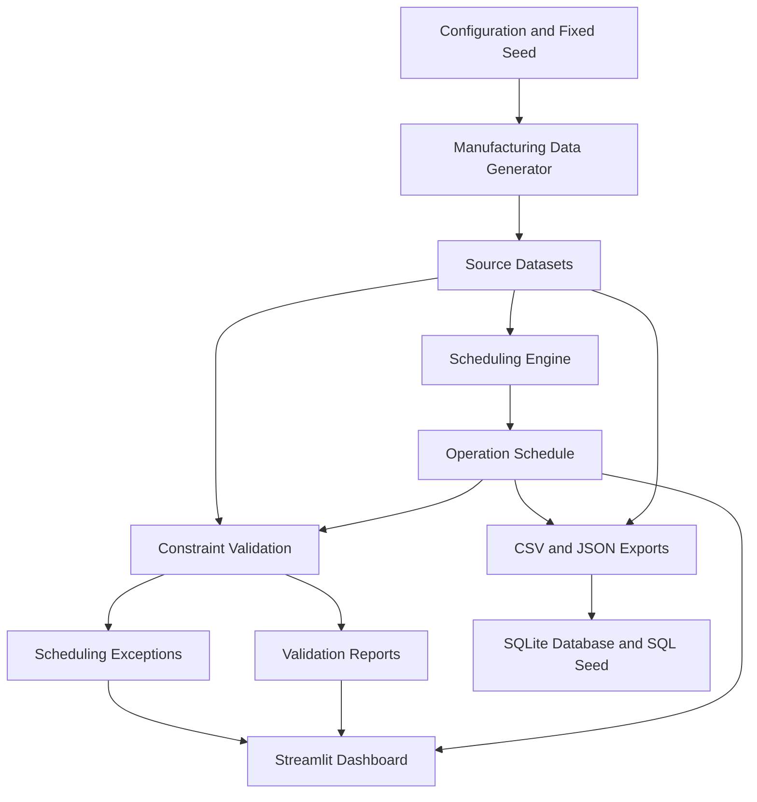

# SmartPlant Scheduler
### Constraint-Aware Production Scheduling & Validation System

[](https://www.python.org/)
[]()
[]()

**SmartPlant Scheduler** is a production scheduling solution designed to manage manufacturing orders, machine assignments, operation sequences, material availability, labor capacity, shared tools, and machine changeovers.

The system generates manufacturing datasets, creates production schedules, validates operational constraints, records scheduling exceptions, and provides an interactive dashboard for exploring production performance.

**Repository:** https://github.com/likhithvancha1216/SmartPlant_Complete

---

## 1. Project Overview

Manufacturing environments involve multiple interconnected constraints. A production operation cannot be scheduled simply because a machine is available. Its materials, labor, tools, routing dependencies, machine calendar, and required changeover time must also be considered.

SmartPlant Scheduler addresses this problem through a structured scheduling and validation workflow.

### Key capabilities

- Production order and operation management.
- Routing and operation precedence handling.
- Machine eligibility and availability checks.
- Machine shift calendar and downtime management.
- Sequence-dependent changeover handling.
- Material and inventory availability validation.
- Labor capacity validation.
- Shared tooling capacity validation.
- Scheduling exception reporting.
- Reproducible manufacturing dataset generation.
- CSV, JSON, SQLite, and SQL seed exports.
- Interactive Streamlit dashboard.

## 2. System Scale

The full-scale dataset uses a fixed random seed of `20261022`.

| Entity | Dataset size |
|---|---:|
| Products / SKUs | 100 |
| Machines | 40 |
| Production orders | 500 |
| Production operations | 2,000 |
| Materials | 200 |
| Scheduled operations | 2,000 |

**Scheduling result:** 2,000 of 2,000 operations scheduled in the verified run.

## 3. System Architecture



### Workflow

1. Generate manufacturing source datasets.
2. Load products, routings, machines, orders, inventory, and resource requirements.
3. Assign operations to eligible machines.
4. Respect operation precedence and resource constraints.
5. Validate the generated schedule.
6. Export schedules, exceptions, and supporting datasets.
7. Explore results through the interactive dashboard.

## 4. Scheduling Constraints

The scheduling and validation workflow addresses the following constraints:

| Constraint | Description |
|---|---|
| Machine availability | Prevent overlapping operations on the same machine |
| Routing precedence | Ensure predecessor operations finish before downstream operations start |
| Machine calendars | Respect machine working shifts |
| Downtime | Account for machine downtime |
| Changeovers | Account for family-dependent setup durations |
| Material availability | Check required material availability |
| Labor capacity | Validate shared labor-group capacity |
| Tool capacity | Validate shared tooling capacity |

## 5. Edge-Case Validation

Five deliberately injected scheduling scenarios are included in the automated test suite.

| Scenario | Expected validation |
|---|---|
| Machine overlap | Detect intersecting machine occupancy |
| Precedence violation | Detect downstream operations starting too early |
| Material before availability | Detect unavailable inventory |
| Outside shift | Detect operations outside machine working calendars |
| Changeover omitted | Detect insufficient setup duration |

The tests modify in-memory copies of the schedule so that the original generated schedule remains unchanged.

## 6. Technology Stack

- **Language:** Python 3.12
- **Data processing:** Pandas
- **Dashboard:** Streamlit
- **Database:** SQLite
- **Data exchange:** CSV and JSON
- **SQL export:** SQLite SQL seed
- **Testing:** Pytest
- **Version control:** Git and GitHub

## 7. Project Structure

```text
SmartPlant_Complete/
│
├── app.py
├── run.py
├── requirements.txt
├── README.md
│
├── START_HERE_MAC.command
├── START_HERE_WINDOWS.bat
│
├── smartplant/
│   ├── config.py
│   ├── generator.py
│   ├── scheduler.py
│   ├── validation.py
│   ├── schedule_validation.py
│   ├── labor_validation.py
│   └── tool_validation.py
│
├── data/
│   ├── products.csv
│   ├── machines.csv
│   ├── routings.csv
│   ├── routing_operations.csv
│   ├── production_orders.csv
│   ├── operations.csv
│   ├── materials.csv
│   ├── inventory_lots.csv
│   ├── machine_calendars.csv
│   ├── machine_downtime.csv
│   ├── changeover_matrix.csv
│   ├── operation_schedule.csv
│   ├── scheduling_exceptions.csv
│   ├── ground_truth.csv
│   ├── event_history.csv
│   ├── source_manifest.json
│   ├── smartplant.db
│   └── smartplant_seed.sql
│
├── docs/
│   ├── ARCHITECTURE.md
│   └── DATA_DICTIONARY.md
│
└── tests/
    ├── test_pipeline.py
    ├── test_edge_cases.py
    └── test_injected_scenarios.py
```

## 8. Installation and Setup

### Prerequisites

- Python 3.10 or later (Python 3.12 recommended)
- Git
- VS Code or another Python IDE

### Clone the repository

```bash
git clone https://github.com/likhithvancha1216/SmartPlant_Complete.git

cd SmartPlant_Complete
```

### Create a virtual environment

macOS / Linux:

```bash
python3 -m venv .venv
source .venv/bin/activate
```

Windows:

```bash
python -m venv .venv
.venv\Scripts\activate
```

### Install dependencies

```bash
python -m pip install --upgrade pip
pip install -r requirements.txt
```

## 9. Run the Application

### Generate datasets and execute the scheduling pipeline

```bash
python run.py
```

### Launch the dashboard

```bash
streamlit run app.py
```

Open the local address displayed in your terminal, usually:

```text
http://localhost:8501
```

The dashboard provides production KPIs, operation breakdowns, machine workload information, schedule exploration, and data downloads.

## 10. Run Validation

Run the independent validation modules:

```bash
python -m smartplant.schedule_validation
```

```bash
python -m smartplant.labor_validation
```

```bash
python -m smartplant.tool_validation
```

## 11. Run Automated Tests

Execute the complete test suite:

```bash
python -m pytest -v
```

### Verified test results

| Test category | Result |
|---|---:|
| Ground-truth scenarios | PASS |
| SQLite database tables | PASS |
| SQL seed export | PASS |
| Machine overlap detection | PASS |
| Precedence violation detection | PASS |
| Outside-shift detection | PASS |
| Material availability detection | PASS |
| Changeover detection | PASS |
| Full-scale source counts | PASS |
| Small-scale scheduling constraints | PASS |

**Latest verified result: 10 tests passed.**

## 12. Reproducibility

The generator uses a fixed seed:

```text
SEED = 20261022
```

Regenerating the CSV datasets using the same configuration produces identical SHA-256 checksums.

This supports repeatable testing and consistent dataset generation.

## 13. Data Exports

The project includes:

- Manufacturing source datasets in CSV format.
- Generated operation schedules.
- Scheduling exception reports.
- Ground-truth scenario definitions.
- Event history.
- Source manifest with checksums.
- SQLite database.
- SQL seed export.

The data dictionary and architecture documentation are available in the `docs/` directory.

## 14. Future Enhancements

Potential future improvements include:

- Advanced optimization using constraint programming.
- Dynamic rescheduling when machine availability changes.
- Real-time supplier acknowledgement integration.
- Production delay and delivery-risk prediction.
- Advanced resource utilization analytics.
- Role-based access and production planning workflows.

## 15. Author and Repository

**Project:** SmartPlant Scheduler  
**Developer:** Vancha Likhith Bharadwaj Reddy

**GitHub:**  
https://github.com/likhithvancha1216/SmartPlant_Complete

---

*SmartPlant Scheduler — Making manufacturing schedules more transparent, traceable, and constraint-aware.*